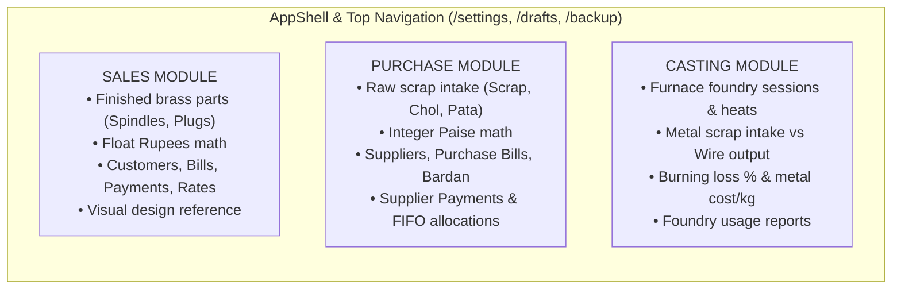

# AI Agent Architecture & Context Guide — Kapil Billing

> **Purpose:** This file is the primary briefing document for any AI assistant (Claude Code, Antigravity, Gemini, GPT) working on Kapil Billing. Read this file first before inspecting or modifying code.

---

## 1. System Identity & Overview

**Kapil Billing** is a high-performance, single-operator desktop accounting and operational ERP application used by a brass metal manufacturing firm in Jamnagar, Gujarat.

### Technology Stack
- **Frontend:** React 19, TypeScript (strict mode), Vite, Tailwind CSS v4.
- **Routing:** TanStack Router (type-safe file-based routing with generated tree in `src/routeTree.gen.ts`).
- **Server State:** TanStack Query v5 (React Query) with custom invalidation pipelines.
- **Backend & Database:** PocketBase (embedded SQLite with WAL mode). Listens on `127.0.0.1:8090`.
- **Web Server / Reverse Proxy:** Caddy. Listens on `127.0.0.1:4174`.
- **Runtime Environment:** Single-user local primary on Windows PC (`runtime/data/data.db`); developer workstation on Arch Linux/CachyOS.

---

## 2. The Three Independent Business Modules

Kapil Billing encompasses **three completely independent business worlds**. They share a UI frame and layout shell, but their data models, calculations, and tables are strictly isolated.



---

## 3. Golden Invariants & Hard Rules (NEVER BREAK)

1. **Strict Module Decoupling (No Cross-Module Item Linking):**
   - **Never link records across modules by name or ID.** An item named `"Chol"` in Casting and `"Chol"` in Purchase are unrelated entities.
   - Do not match furnace melting inputs to raw purchase inventory (e.g. no substring matching like `if (name.includes('brass'))`).
2. **Distinct Accounting Models (Never Net Receivables vs Payables):**
   - **Sales** uses standard float Rupees (`amount`, `total`, `opening_balance`).
   - **Purchase** uses integer math: `weight_g` (grams), `rate_milli` (milli-rupees), `amount_paise` (paise).
   - **Never net customer outstanding against supplier payables.** There is no combined "company net position" figure.
3. **Database Migration Safety:**
   - **Never edit or delete past migrations** in `pb_migrations/`.
   - Always add **new migration files** with fresh Unix timestamps (e.g., `1794640008_...`).
   - PocketBase auto-applies pending migrations on startup. Never run migrations against the live database without telling the user to run `windows\backup-kapil.ps1` first.
4. **Soft-Delete Philosophy:**
   - Parties (`customers`, `suppliers`) are **never hard-deleted**; they possess an `active: bool` flag.
   - Items referenced in any historical bill line or casting input have delete **blocked** in the UI, offering a "Deactivate" toggle instead. Only items with 0 transactions can be deleted.
5. **Design Language Standards:**
   - **Page Background:** `#f1f5f9` (`bg-slate-100`).
   - **Font:** `Geist Variable` (self-hosted in `/fonts/`).
   - **Cards / Containers:** `rounded-xl border border-slate-200 bg-white p-5 shadow-sm`.
   - **Tables:** Sticky `thead bg-slate-50`, th `px-3 py-2 text-xs font-semibold uppercase tracking-[0.08em] text-slate-500`, rows `border-t border-slate-100 px-3 py-2`, money `font-mono tabular-nums`.
   - **Buttons:** Primary `bg-slate-900 text-white` (never `bg-blue-600`), secondary white with `border-slate-300`.
   - **Page Titles:** The AppShell top bar owns the page title and subtitle. Pages **never** render duplicate `<h1>` headers.
   - **Modals vs Drawers:** Small actions use centered Radix dialogs (`Esc` closes, `Ctrl+Enter` submits). **No slide-over side drawers.**

---

## 4. Directory Structure & Boundaries

```text
Kapil_pro/
├── docs/                   # System documentation & build plans
│   ├── architecture/       # System design, data flow, AI-CONTEXT.md (this file)
│   ├── features/           # Active build plans (kapil-restructure-build-plan.md, restructure-progress.md)
│   └── operations/         # Runbooks, backup, and health check docs
├── pb_migrations/          # PocketBase SQLite schema migrations
├── runtime/                # Local PocketBase and Caddy binaries (do not commit data)
├── scripts/                # Market rate RSS watcher, seeders, and smoke test suites
├── src/
│   ├── app/                # App bootstrap, router, providers, errors, query-invalidation
│   ├── components/         # Shared UI and domain presentation components
│   │   ├── layout/         # AppShell, SidebarNavPanel, QuickSearchPreview
│   │   ├── ui/             # Standard primitives (DataTable, Panel, ConfirmDialog, FormField, etc.)
│   │   ├── suppliers/      # Purchase bills table, chitty, payment modals, supplier form
│   │   ├── items/          # Master items table and modals
│   │   └── reports/        # Trend charts (Recharts) and company report components
│   ├── config/             # Business rules, firm metadata
│   ├── data/               # PocketBase API queries and mutations (IO layer only)
│   ├── domain/             # Pure financial calculations & business logic (Zero React dependencies)
│   ├── lib/                # Pure utility functions: date, inr-format, search, export
│   └── routes/             # TanStack Router route files
└── windows/                # Windows PowerShell automation (backup, start, stop, health-check)
```

---

## 5. PocketBase Data Collections

| Collection | Module | Primary Fields & Purpose |
| :--- | :---: | :--- |
| `items` | Sales | Finished goods: `name`, `default_rate`, `type` (gas/electronic), `unit`, `bag_weight`, `group`, `active` |
| `customers` | Sales | Buyers: `company_name`, `name`, `phone`, `gstin`, `opening_balance` (₹), `credit_limit`, `active` |
| `bills` | Sales | Invoices: `book_no`, `bill_no`, `date`, `customer`, `mkt`, `transport`, `gst_rate`, `status` |
| `bill_items` | Sales | Invoice lines: `bill` (rel), `item` (rel), `item_name` (copy), `qty`, `rate`, `amount`, `bags` |
| `payments` | Sales | Customer collections: `customer` (rel), `date`, `amount` (₹), `mode`, `note` |
| `purchase_items` | Purchase | Raw scrap catalog: `name`, `active` (Unique index on `name`) |
| `suppliers` | Purchase | Scrap vendors: `company_name`, `phone`, `opening_kacha_paise`, `opening_gst_paise`, `active` |
| `purchase_bills` | Purchase | Inward bills: `in_no` (Unique, e.g. IN-2627-0001), `date`, `supplier`, `pool` (kacha/gst), `cancelled` |
| `purchase_bill_lines` | Purchase | Scrap lines: `bill`, `item`, `item_name`, `weight_g`, `rate_milli`, `amount_paise` |
| `purchase_bardan` | Purchase | Empty bag deductions: `bill`, `bardan_g`, `rate_milli`, `credit_paise`, `method` |
| `supplier_payments` | Purchase | Outward payments: `supplier`, `date`, `amount_paise`, `pool`, `mode`, `cancelled` |
| `supplier_payment_allocations` | Purchase | FIFO settlements: `payment`, `bill`, `amount_paise` |
| `casting_materials` | Casting | Foundry materials master: `name`, `code`, `category`, `is_active` |
| `casting_sessions` | Casting | Furnace runs: `date`, `total_input_kg`, `total_wire_out`, `burning_loss_pct`, `metal_cost_per_kg` |
| `casting_batch_inputs` | Casting | Furnace batch inputs: `batch`, `material`, `material_name`, `qty`, `rate`, `amount` |
| `app_settings` | Global | Singleton (`id: "global_settings"`): `purchase_enabled: bool`, `casting_enabled: bool` |
| `bill_drafts` / `payment_drafts`| Muse AI | Staged WhatsApp photos and bank SMS parsed by background AI worker |

---

## 6. Route & Navigation Map

- `/` — **Main Dashboard:** Month & FY selector, cross-module flow KPIs, Pay Next, Collect Next, Latest bills.
- `/drafts` — **AI Drafts:** Staged bills and payments review from Muse AI.
- `/ledger` — **Party Ledger:** Dual tabs: `Customers` (sales statements, PDF/XLSX/ZIP export) and `Suppliers` (scrap ledger, JPG export).
- `/new-bill` — **Sale Bills:** Keyboard-first creation of sales invoices.
- `/new-payment` — **Sales Payment:** Customer collection recording with auto-balance adjustment.
- `/transactions` — **Sales Logs:** Filterable, paginated transaction log with local trash restore.
- `/new-purchase-bill` — **New Purchase Bill:** Scrap purchase bill entry with live chitty slip and bardan calculation.
- `/new-supplier-payment` — **New Purchase Payment:** Outgoing supplier payment with auto-settlement.
- `/purchase-bills` — **Purchase Bills Hub:** Filterable inward scrap bills, payments tab, and bardan worklist.
- `/purchase-bills/$billId` — **Bill Chitty:** Detailed printable thermal slip for raw scrap inward deliveries.
- `/purchase-logs` — **Purchase Logs:** Unified 90-day paginated log of purchase bills, payments, and audit events.
- `/casting/index` — **Casting Dashboard:** Foundry yields, furnace runs, wire output, cost per kg.
- `/casting/new-session` — **New Casting Session:** Record heats, metal inputs, output wire kg, and loss %.
- `/casting/log` — **Casting Logs:** Furnace logs with local trash/restore.
- `/items` — **Items Master:** Three clean tabs: `Sale Items`, `Purchase Items`, and `Casting Items` (each with full CRUD on its own table).
- `/monthly-sales-calendar` — **Calendar:** Daily sales, purchase totals, and casting runs in day cells.
- `/monthly-report` — **Company Report:** FY selector, Gross Sales, Collections, Purchase summary, Casting summary, CSV/JPG export.
- `/settings` — **Settings:** Module toggles (Purchase & Casting on/off), defaults, backup links.

*Redirects Enforced:*
- `/customers` $\to$ `/ledger?tab=customers`
- `/suppliers` $\to$ `/ledger?tab=suppliers`
- `/supplier-payments` $\to$ `/new-supplier-payment`
- `/purchase-items` $\to$ `/items?tab=purchase`
- `/casting/materials` $\to$ `/items?tab=casting`
- `/bardan-pending` $\to$ `/purchase-bills?tab=bardan`
- `/calendar` $\to$ `/monthly-sales-calendar`

---

## 7. Developer & AI Commands

Always execute commands inside `/home/arch/project/Kapil_pro`:

```bash
# 1. Full Quality Verification (Runs typecheck, tests, and build)
npm run verify

# 2. Run Test Suite (Vitest)
npm test

# 3. Run Single Test File
npx vitest run src/domain/dashboard.test.ts

# 4. Generate TanStack Routes (Required when adding/renaming files in src/routes/)
npm run router:generate

# 5. Typecheck
npm run typecheck

# 6. Production Build
npm run build
```

---

## 8. Where to Edit What (AI Quick Reference)

| Task | Files to Inspect & Edit |
| :--- | :--- |
| **Sales Calculations & Invoicing** | [`src/domain/billing-calculations.ts`](file:///home/arch/project/Kapil_pro/src/domain/billing-calculations.ts), [`src/data/bills.ts`](file:///home/arch/project/Kapil_pro/src/data/bills.ts), [`src/routes/new-bill.tsx`](file:///home/arch/project/Kapil_pro/src/routes/new-bill.tsx) |
| **Purchase Formulas & Unit Conversion** | [`src/domain/supplier-units.ts`](file:///home/arch/project/Kapil_pro/src/domain/supplier-units.ts), [`src/domain/supplier-settlement.ts`](file:///home/arch/project/Kapil_pro/src/domain/supplier-settlement.ts), [`src/data/suppliers.ts`](file:///home/arch/project/Kapil_pro/src/data/suppliers.ts) |
| **Casting Calculations** | [`src/domain/casting-calculations.ts`](file:///home/arch/project/Kapil_pro/src/domain/casting-calculations.ts), [`src/data/casting.ts`](file:///home/arch/project/Kapil_pro/src/data/casting.ts), [`src/routes/casting/`](file:///home/arch/project/Kapil_pro/src/routes/casting/) |
| **Main Dashboard Aggregations** | [`src/domain/dashboard.ts`](file:///home/arch/project/Kapil_pro/src/domain/dashboard.ts), [`src/domain/purchase-dashboard.ts`](file:///home/arch/project/Kapil_pro/src/domain/purchase-dashboard.ts), [`src/routes/index.tsx`](file:///home/arch/project/Kapil_pro/src/routes/index.tsx) |
| **Module Settings & Route Gates** | [`src/data/module-settings.ts`](file:///home/arch/project/Kapil_pro/src/data/module-settings.ts), [`src/lib/module-settings.ts`](file:///home/arch/project/Kapil_pro/src/lib/module-settings.ts), [`src/routes/settings.tsx`](file:///home/arch/project/Kapil_pro/src/routes/settings.tsx) |
| **Shared UI Primitives** | [`src/components/ui/`](file:///home/arch/project/Kapil_pro/src/components/ui/) (`data-table.tsx`, `panel.tsx`, `confirm-dialog.tsx`, `status-chip.tsx`, `money-cell.tsx`) |
| **Form Styling & Focus Rings** | [`src/components/ui/form-control-classes.ts`](file:///home/arch/project/Kapil_pro/src/components/ui/form-control-classes.ts), [`src/index.css`](file:///home/arch/project/Kapil_pro/src/index.css) |
| **React Query Invalidation** | [`src/app/query-invalidation.ts`](file:///home/arch/project/Kapil_pro/src/app/query-invalidation.ts), [`src/app/providers.tsx`](file:///home/arch/project/Kapil_pro/src/app/providers.tsx) |
| **Print & Statement Exports** | [`src/lib/bill-print-export.tsx`](file:///home/arch/project/Kapil_pro/src/lib/bill-print-export.tsx), [`src/lib/image-export.ts`](file:///home/arch/project/Kapil_pro/src/lib/image-export.ts), [`src/routes/export-reports.tsx`](file:///home/arch/project/Kapil_pro/src/routes/export-reports.tsx) |
