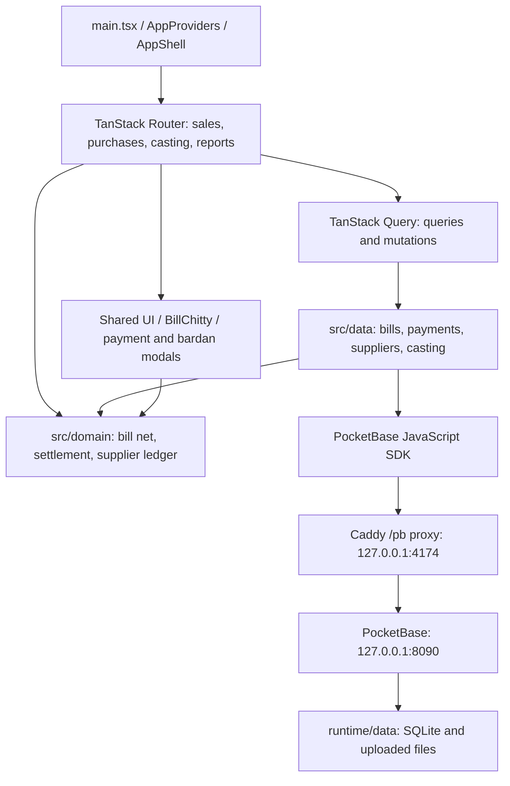

# Kapil Pro purchase review — 7 November 2026

Kapil Pro's purchase screens compile and pass the existing tests, but this review found financial inconsistencies and purchase-entry regressions that should be corrected before expanding the module.

**Audience:** project owner and the next implementation agent.  
**Reader job:** understand the current project and decide which bugs to fix first.  
**Reviewed state:** `feat/muse-integration`, HEAD `06de703`, plus the existing uncommitted worktree.  
**Scope:** architecture overview; deep inspection of supplier purchases, payments, settlement, ledger, chitty, and new purchase logs; targeted checks of shared layout, item master, casting changes, and Linux operator scripts.

## Project in brief

- **Product:** Kapil Products billing and casting workspace, with customer sales and collections, supplier scrap purchases and payments, bardan settlement, casting sessions, reporting, exports, and master data.
- **Frontend:** React 19 + TypeScript, Vite, TanStack Router and Query, Tailwind, Radix-based UI, Recharts, React Hook Form and Zod.
- **Backend:** the frontend reads and writes PocketBase directly; PocketBase persists business collections in SQLite. Caddy serves the built frontend and proxies `/pb` to PocketBase.
- **Boundaries:** screens/workflows in `src/routes`; persistence and mapping in `src/data`; financial math in `src/domain`; reusable UI in `src/components`; formatting and exports in `src/lib`.
- **Purchase model:** supplier header → purchase bill → material lines / adjustments / bardan; supplier payments optionally have explicit bill pins. Settlement computes the remaining FIFO allocations rather than persisting them all.
- **Money:** integer paise, weight in grams, rates in milli-rupees/kg, tax in basis points. Kacha and GST credit pools are separate.

The graph indexed **225 files under `src`**: 130 `.ts`, 93 `.tsx`, 2 `.css`. Its scoped call-cycle scan found no cycles; this is a static signal, not proof that all runtime paths are acyclic. Test line/branch coverage was not measured.

## Verification

| Check | Result |
| --- | --- |
| `npm run test` | 318 passed, 2 skipped; 50 passing test files and 2 skipped |
| `npm run typecheck` | Passed |
| `npm run build` | Passed |
| `npm run lint` | 0 errors, 59 warnings |
| `git diff --check` | Passed |
| `bash scripts/linux/health-check.sh` | PocketBase, Caddy, and `/pb` health checks passed |
| Focused executable audit reproductions | 7 cases reproduced using actual domain/render/cache code and mocked payment persistence |

The three scripts composing `npm run verify` were run individually. The focused reproductions are in `/tmp/opencode/kapil-purchase-audit-repros.mjs`; run them with `node /tmp/opencode/kapil-purchase-audit-repros.mjs` while this temporary file remains available. They use the project's Vite module loader and SDK mocks, with **zero live database writes**. Live browser inspection covered the dashboard and purchase-entry screen; this review did not repeat the previous agent's full mobile/desktop interaction sweep or submit transactions.

## Ranked findings

### 1. High — opening advances never settle purchase bills

**Origin:** pre-existing in HEAD; directly affects the new credit-aware preview.  
**Locations:** `src/domain/supplier-settlement.ts:259-264,405-419`; `src/routes/new-purchase-bill.tsx:880-897`.

Negative opening amounts increase `advancePaise`, but only payment records call `drain`. The `rowForApplied === null` opening-credit recording branch is never invoked.

**Reproduction:** ₹50,000 opening advance plus an ₹80,000 kacha bill produces ₹80,000 outstanding and ₹50,000 available advance. Expected: ₹30,000 outstanding and zero remaining advance. The combined net position happens to be correct, but the individual bill status, amount due, supplier due card, and available advance are wrong.

**Fix direction:** apply the opening credit within its pool to the payable queue and record consumed opening credits on bill rows; expose only the unconsumed amount as advance. Cover smaller/larger bills, refunds, and pool separation.

### 2. High — a successful supplier payment can be reported as failed and duplicated

**Origin:** pre-existing in HEAD, still present in the updated payment entry flow.  
**Locations:** `src/data/suppliers.ts:998-1011`; `src/routes/new-supplier-payment.tsx:232-270`.

`batch.send()` commits the payment, but the function then requires a separate `getOne` response. If that read fails, the mutation follows the error path with the original form intact. Saving again generates a fresh payment id, creating a duplicate. The new purchase-bill creation path addresses this problem; supplier payment creation does not.

**Reproduction:** mocked successful batch commit followed by a failed read rejects the operation; a manual retry produces two committed payments with distinct ids for one ₹1,000 entry.

**Fix direction:** return the committed record from the batch response and treat later reads/uploads as refresh work. For lost batch responses, retain the original operation/record id and reconcile its existence before allowing a new write. Apply the same review to bardan creation and bill updates.

### 3. High — GST bardan deductions disagree between ledger and settlement

**Origin:** pre-existing in HEAD.  
**Locations:** `src/domain/supplier-ledger.ts:106-114,130-142`; `src/domain/supplier-purchases.ts:150-163`.

The settlement recalculates GST on the taxable amount after bardan deduction. The ledger first records the original GST-inclusive bill, then subtracts only the bardan's base credit, missing the tax reduction and any resulting rounding change.

**Reproduction:** ₹1,00,000 base + 18% GST, followed by ₹10,000 bardan deduction: settlement says **₹1,06,200**; ledger closes at **₹1,08,000**. Difference: ₹1,800.

**Fix direction:** derive each monetary bardan event from the change in `computeBillNet` rather than subtracting its raw credit, preserving event dates and integer rounding.

### 4. High — bardan advance is credited twice in the supplier ledger

**Origin:** pre-existing in HEAD.  
**Locations:** `src/domain/supplier-ledger.ts:130-164`; `src/data/suppliers.ts:875-889`.

Adding bardan with method `advance` creates a `bardan_advance` payment. The ledger also treats the bardan row itself as a monetary credit, then credits the payment a second time. Settlement correctly counts only the payment.

**Reproduction:** ₹1,000 bill and ₹100 bardan advance: settlement owes **₹900**; ledger owes **₹800**.

**Fix direction:** keep the bardan advance event informational when its linked payment carries the financial effect; count the credit once and preserve the link for cancellation/reconciliation.

### 5. High — cancelling a bill leaves its bardan deductions active in the ledger

**Origin:** pre-existing in HEAD.  
**Locations:** `src/data/suppliers.ts:377-401`; `src/domain/supplier-ledger.ts:106-107,130-142`.

`bundleToLedgerInput` filters cancelled bill lines and adjustments but passes all bardan. The ledger checks `entry.cancelled`, without checking the parent bill's cancellation. Settlement excludes the cancelled bill's monetary effect, while its bardan remains a ledger credit.

**Reproduction:** a cancelled ₹1,000 bill with ₹100 bardan deduction yields a **−₹100 ledger balance**, where the cancelled bill and its deduction should have zero net effect.

**Fix direction:** exclude or mark parent-cancelled bardan in the shared ledger input/domain. Independently recorded supplier payments must retain their own cancellation semantics.

### 6. High — new BANK payment mode is rejected by the supplied PocketBase schema

**Origin:** introduced in the current worktree.  
**Locations:** `src/routes/new-supplier-payment.tsx:46,391-402`; `pb_migrations/1794640003_created_supplier_payment_collections.js:24`.

The page offers `bank` and sends it unchanged as `mode`. The current collection migration permits only `cash`, `upi`, `rtgs`, `neft`, `cheque`, and `other`; no later source migration adds `bank`. Against this supplied schema, choosing BANK makes an otherwise valid payment fail validation. SDK-mocked tests do not enforce backend enum values.

**Fix direction:** use the existing specific transfer methods, or add an intentional schema migration and shared mode definition. This audit did not alter the live schema or test a live write.

### 7. Medium — chitty shows false bardan money deductions at ten times the correct value

**Origin:** introduced in the current worktree.  
**Location:** `src/components/suppliers/bill-chitty.tsx:412-434`.

When `creditPaise` is zero, the renderer calculates `bardanG * rateMilli / 1000`; integer paise conversion requires `/10000`. It uses this fallback for `in_kind` and `cash_back`, even though those methods have no payable effect. It also labels advance as a deduction in addition to the actual payment, and places already-netted bardan under the bill net as though it were another subtraction.

**Reproduction:** an in-kind row with 1 kg at ₹800/kg renders a **−₹8,000** bardan deduction, while the same chitty's balance remains ₹800 and the domain correctly applies no deduction.

**Fix direction:** render bardan according to method: deduct = actual recorded bill deduction, in-kind = informational, cash-back = recorded cash memo, advance = linked credit event. Use `lineAmountPaise` for any weight/rate conversion and distinguish amounts already included in the bill net.

### 8. Medium — entered per-line bags/bardan disappear after saving

**Origin:** introduced in the current worktree.  
**Locations:** `src/routes/new-purchase-bill.tsx:1351-1357,1472-1480,998-1005,1027-1033`.

The new `bardanStr` control appears in the live print preview, but both create and update payloads omit it. Reloaded lines have no equivalent persisted field, and edit prefill explicitly sets it to an empty string. A user can enter bag information, see it in the preview, save, and lose it.

**Fix direction:** define and persist the intended per-line bag count/memo, including edit prefill and print mapping. Keep a receipt memo separate from a later monetary bardan settlement.

### 9. Medium — purchase audit feed remains cached after writes

**Origin:** introduced with the new purchase logs route.  
**Locations:** `src/routes/purchase-logs.tsx:137`; `src/app/query-invalidation.ts:19-37`.

The audit feed uses `['purchase-logs-audit']`. Shared purchase write invalidation never targets that key. After a write, financial lists can refresh while the audit view retains old entries until a later refetch; there is no automatic periodic/focus refetch for this feed.

**Reproduction:** seed both query keys and call the actual invalidation helper: purchase bills become invalidated, audit feed does not.

**Fix direction:** add the audit feed to centralized invalidation and use shared query-key definitions.

### 10. Medium — purchase logs confuse cash direction and omit parts of outstanding

**Origin:** introduced with the new purchase logs route.  
**Locations:** `src/routes/purchase-logs.tsx:192-209,260-281,353-381`.

Every supplier payment is treated as a positive paid-out amount. `refund_received` is incoming money; `settle_off` and `bardan_advance` are non-cash credits. Meanwhile, the card called “Net Outstanding” sums only bill dues, omitting unpaid opening balances, refund payables, and available advances.

**Concrete scenarios:** a ₹10,000 refund inflates “Total Paid Out” by ₹10,000; a supplier with ₹5,000 opening payable and no bills appears as zero outstanding in logs even while the supplier summary shows ₹5,000 due.

**Fix direction:** separate cash payments, incoming refunds, and non-cash credits; obtain the chosen outstanding/net-position metric from settlement summaries and label it consistently.

### 11. Medium — direct-process Linux backup leaves the app stopped

**Origin:** introduced with the new Linux scripts.  
**Locations:** `scripts/linux/backup-kapil.sh:11-26`; `scripts/linux/stop-kapil.sh:9-28`.

The direct-process branch invokes `stop-kapil.sh`, which stops Caddy and PocketBase. The exit trap restarts only systemd-managed PocketBase when `systemd_was_active` is true; it has no restart path for the direct-process branch. An operator starting the app with `start-kapil.sh` and then backing it up loses both services until manually starting them again.

**Fix direction:** capture each service's initial state and restore that state in the exit trap for both supported launch modes. Do not test this correction against an active business database without the project's operator safeguards.

## Why the existing tests missed these cases

- Settlement tests cover positive opening payables but not a negative opening advance followed by bills.
- The reconciliation test containing `bardan_advance` supplies a payment without the bardan advance row that real persistence creates.
- GST and bardan deductions are tested separately, not as a combined reconciliation scenario.
- Cancellation tests omit related monetary bardan rows.
- Supplier audit tests mock `send()` and reads without the backend's enum constraints; the current save-uncertainty test applies to bill creation, not payment creation.
- Chitty total tests do not inspect the rendered fallback bardan amount or method-specific explanation.

## Maintainability observations

The layer structure is useful and should be retained. The main maintenance pressure comes from large workflow files and repeated orchestration:

| File | Approximate lines |
| --- | ---: |
| `src/routes/new-bill.tsx` | 2,237 |
| `src/components/layout/app-shell.tsx` | 2,075 |
| `src/routes/new-purchase-bill.tsx` | 1,917 |
| `src/routes/export-reports.tsx` | 1,734 |
| `src/data/suppliers.ts` | 1,649 |
| `src/routes/items.tsx` | 1,426 |
| `src/routes/supplier-ledger.$supplierId.tsx` | 1,161 |

Payment-row/chitty assembly is repeated in the purchase list, individual bill page, and new print page. The newly added drawer also reads manual pins rather than actual settlement credits, but has no call site in the current source, so it is not reported as a reachable defect. The graph indexed 46 `src` test files; the test runner's 52 files include other test locations and skipped emit checks. Coverage percentages were not measured.

## Next implementation order

1. Correct ledger/settlement reconciliation: opening credit consumption, GST bardan delta, advance single-counting, and cancellation.
2. Make payment saves resilient to lost responses and failed post-save reads, with stable transaction identity.
3. Align payment mode UI with the backend schema.
4. Correct bardan persistence and chitty explanations, then audit-log cache/financial metrics.
5. Correct the Linux backup lifecycle and add targeted regression coverage for the real combinations above.

The documentation calls this the Windows-primary edition, while the actual checked-out branch is `feat/muse-integration` and the local Linux services are healthy. Before implementation that affects runtime or database behavior, confirm **which machine currently owns the writable business database: Windows or this Arch machine?**

## Review limits and artifacts

This is a focused code and executable-logic audit, not a claim of exhaustive coverage of every sales/export workflow. No application source or business records were changed by the audit; the only project addition is this report. The temporary HTML report and reproduction script are under `/tmp/opencode`.

The optional DEV community lookup was unavailable because MLH sign-in timed out; no unverified community claims are used. Current SDK/query behavior was checked against PocketBase SDK and TanStack Query documentation through Context7, and the invalidation/payment failure findings were independently reproduced locally.
